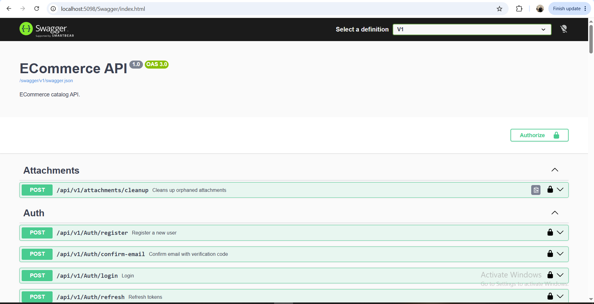
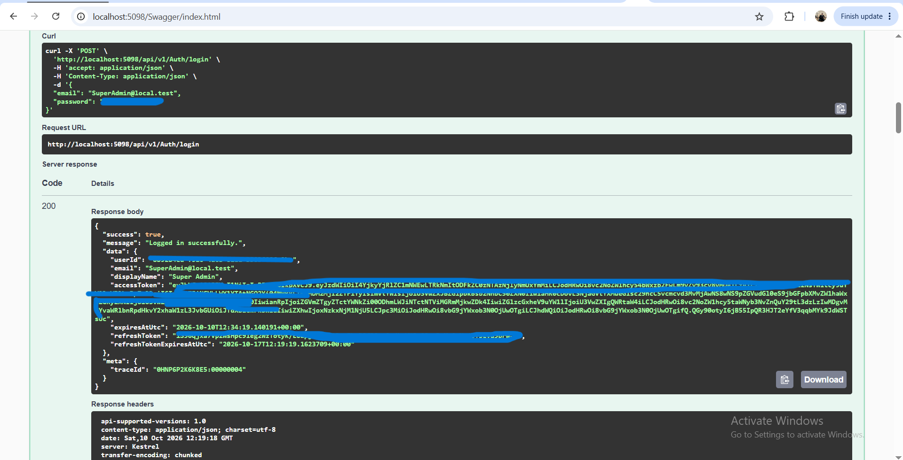
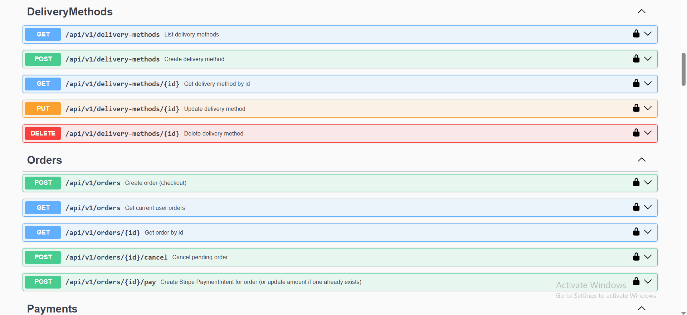
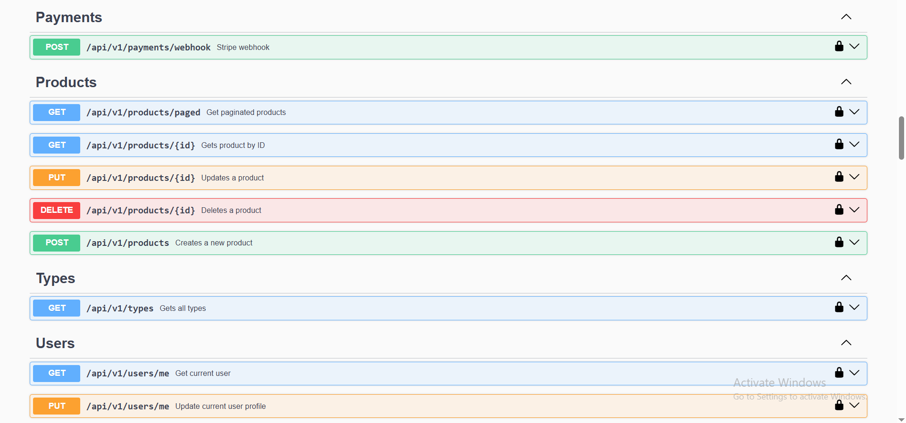

# ECommerce API


A production-minded e-commerce backend built with **ASP.NET Core (.NET 10)**, **Clean / Onion Architecture**, **CQRS**, and a security-first approach to authentication, authorization, and payments.




## Table of Contents

- [Features](#features)
- [Tech Stack](#tech-stack)
- [Architecture](#architecture)
- [Project Structure](#project-structure)
- [Getting Started](#getting-started)
- [Configuration](#configuration)
- [API Overview](#api-overview)
- [Security](#security)
- [Testing](#testing)
- [Known Issues & Roadmap](#known-issues--roadmap)

---

## Features

**Identity & Access**
- Registration with **email verification code** (6 digits, 15-minute expiry, limited attempts)
- Login with **JWT access tokens** and **rotating refresh tokens** (stored hashed, reuse detection)
- **Account lockout** after repeated failed logins
- **Per-IP rate limiting** on all auth endpoints
- Role-based authorization (`User`, `SuperAdmin`)

**Catalog**
- Products, brands, and product types
- Paginated, filterable, sortable product listing with **output caching**
- Product images uploaded to **Cloudinary**, with orphaned-attachment cleanup (admin only)
- Soft delete for products

**Basket**
- Redis-backed basket using **HybridCache** (in-memory L1 + Redis L2)
- Guest baskets and authenticated baskets, with **merge on login**

**Orders & Payments**
- Orders tied to the authenticated user (users can only see their own orders)
- Delivery methods and saved user addresses
- **Stripe** payment intents with idempotency keys
- Stripe **webhook** with signature verification
- Order cancellation

**Engineering**
- CQRS with a custom mediator and pipeline behaviors (validation)
- Result pattern instead of exceptions for expected failures
- Specification pattern, Repository + Unit of Work
- Two separate DbContexts (store data and identity) with separate schemas
- API versioning (`/api/v1/...`) and Swagger (Development)
- Integration tests and **architecture tests** that enforce layer boundaries

---

## Tech Stack

| Area | Technology |
|---|---|
| Framework | ASP.NET Core Minimal APIs, .NET 10 |
| Database | SQL Server, EF Core |
| Identity | ASP.NET Core Identity (`AddIdentityCore`), JWT Bearer |
| Caching | HybridCache + Redis (StackExchange.Redis) |
| Payments | Stripe.net |
| Images | CloudinaryDotNet |
| Email | FluentEmail + SMTP |
| Validation | FluentValidation |
| Mapping | Mapster |
| Versioning / Docs | Asp.Versioning, Swashbuckle (Swagger) |
| Testing | xUnit, `Microsoft.AspNetCore.Mvc.Testing`, NetArchTest, Shouldly |

---

## Architecture

The solution follows **Clean (Onion) Architecture**. Dependencies point inward only.

```
ECommerce.API ──────────┐
                        ├──►  ECommerce.UseCases  ──►  ECommerce.Domain
ECommerce.Infrastructure┘
```

| Layer | Responsibility |
|---|---|
| **Domain** | Entities, value rules, errors, the `Result` type, repository abstractions. No external dependencies. |
| **UseCases** | Commands, queries, handlers, validators, DTOs, specifications, and interfaces for infrastructure services. |
| **Infrastructure** | EF Core DbContexts and migrations, Identity, JWT, Stripe, Cloudinary, email, Redis caching, seeding. |
| **API** | Minimal API endpoints, DI composition, middleware, Swagger, rate limiting. |

### Request pipeline

```
HTTP request
  → Exception handler → Rate limiter → Authentication → Authorization → Output cache
  → Endpoint (maps request DTO → command/query)
  → Mediator pipeline: ValidationBehavior (FluentValidation)
  → Handler (Domain rules + repositories)
  → Result<T> → mapped to an HTTP response (ProblemDetails-style on failure)
```

Layer rules are enforced by tests in `ECommerce.ArchitectureTests`, so a wrong reference fails the build pipeline instead of slipping in silently.

---

## Project Structure

```
ECommerce-RestfullApi-Project
├─ ECommerce.slnx
├─ ECommerce.API/                    # Endpoints, DI, middleware, Swagger
├─ ECommerce.UseCases/               # CQRS commands/queries, handlers, validators
├─ ECommerce.Domain/                 # Entities, errors, Result, abstractions
├─ ECommerce.Infrastructure/         # EF Core, Identity, Stripe, Cloudinary, caching
├─ ECommerce.Api.IntegrationTests/   # API-level tests (WebApplicationFactory)
└─ ECommerce.ArchitectureTests/      # Layer dependency rules (NetArchTest)
```

---

## Getting Started

### Prerequisites

- [.NET 10 SDK](https://dotnet.microsoft.com/download)
- SQL Server (LocalDB or a full instance)
- Redis (e.g. `docker run -p 6379:6379 redis`)
- A local SMTP server for email verification codes, such as [smtp4dev](https://github.com/rnwood/smtp4dev) (listening on port 25)
- A [Stripe](https://stripe.com) test account and the [Stripe CLI](https://stripe.com/docs/stripe-cli)
- A [Cloudinary](https://cloudinary.com) account

### 1. Clone

```bash
git clone https://github.com/EslamMagdy33/ECommerce-RestfullApi-Project.git
cd ECommerce-RestfullApi-Project
```

### 2. Set secrets

Secrets are **never committed**. Use .NET user-secrets (values below are examples):

```bash
cd ECommerce.API

dotnet user-secrets set "Jwt:Secret" "<at-least-32-characters-random-string>"

dotnet user-secrets set "Stripe:SecretKey" "sk_test_..."
dotnet user-secrets set "Stripe:WebhookSecret" "whsec_..."

dotnet user-secrets set "CloudinarySettings:ApiKey" "<your-api-key>"
dotnet user-secrets set "CloudinarySettings:ApiSecret" "<your-api-secret>"

dotnet user-secrets set "Seed:SuperAdmin:Password" "<a-strong-password>"
```

### 3. Check the connection strings

In `appsettings.Development.json`, make sure `ConnectionStrings:DefaultConnection` points to your SQL Server and `ConnectionStrings:Redis` to your Redis instance.

### 4. Run

```bash
dotnet run --project ECommerce.API --launch-profile http
```

In **Development**, on startup the app automatically:
- applies EF Core migrations for both DbContexts,
- seeds brands, product types, delivery methods, and the SuperAdmin account.

Swagger UI: `http://localhost:5098/swagger`

> Migrations and seeding run in Development only. A production strategy is on the [roadmap](#known-issues--roadmap).

### 5. Stripe webhooks (local)

```bash
stripe listen --forward-to http://localhost:5098/api/v1/payments/webhook
```

Copy the `whsec_...` value the CLI prints into the `Stripe:WebhookSecret` user-secret, then trigger events with `stripe trigger payment_intent.succeeded`.

### 6. Try the auth flow

1. `POST /api/v1/Auth/register`, then read the verification code from your SMTP dev server.
2. `POST /api/v1/Auth/confirm-email` with the code.
3. `POST /api/v1/Auth/login` returns an access token and a refresh token.
4. Use **Authorize** in Swagger with `Bearer <access token>`.

Or log in directly with the seeded SuperAdmin (email from `Seed:SuperAdmin:Email`) to test admin-only endpoints.

---

## Configuration

| Section / key | Purpose |
|---|---|
| `ConnectionStrings:DefaultConnection` | SQL Server (both DbContexts, separate schemas and migration history tables) |
| `ConnectionStrings:Redis` | Redis for HybridCache |
| `Jwt:Secret`, `Jwt:Issuer`, `Jwt:Audience` | JWT signing and validation (secret must be at least 32 characters) |
| `Jwt:AccessTokenExpirationMinutes`, `Jwt:RefreshTokenExpirationDays` | Token lifetimes (default 15 minutes / 7 days) |
| `Stripe:SecretKey`, `Stripe:WebhookSecret`, `Stripe:PublishableKey`, `Stripe:Currency` | Stripe integration |
| `CloudinarySettings:CloudName`, `ApiKey`, `ApiSecret` | Image storage |
| `Email:Host`, `Port`, `FromEmail`, `FromName` | SMTP sender |
| `EmailVerification:CodeLength`, `ExpirationMinutes`, `MaxFailedAttempts` | Verification code policy |
| `CachedAggregates:Basket:*` | Basket cache lifetimes (30-day absolute, 7-day sliding by default) |
| `Seed:SuperAdmin:*` | Development seed account |

In non-Development environments, provide all secrets through environment variables (e.g. `Jwt__Secret`), not files.

---

## API Overview

Base path: `/api/v1`. The full, always-current contract is in Swagger.

| Group | Endpoints | Access |
|---|---|---|
| **Auth** | `POST /Auth/register`, `/confirm-email`, `/login`, `/refresh`, `/logout` | Public (rate limited) |

| **Products** | `GET /products/paged`, `GET /products/{id}` | Public |
| | `POST /products`, `PUT /products/{id}`, `DELETE /products/{id}` | **SuperAdmin** |
| **Basket** | `GET/DELETE /basket`, `POST /basket/items`, `PUT/DELETE /basket/items/{productId}`, `POST /basket/merge` | Guest (`X-Buyer-Id` header) or authenticated |
| **Brands / Types / Delivery methods** | CRUD and listing | See Swagger |
| **Users** | Profile and addresses | Authenticated |
| **Orders** | Create, list my orders, get by id, cancel, create payment | Authenticated (owner only) |

| **Payments** | Stripe webhook | Public, signature verified |

| **Attachments** | `POST /attachments/cleanup` (removes orphaned images) | **SuperAdmin** |

Failures are returned in a consistent ProblemDetails-style shape (`type`, `title`, `status`, `detail`/`errors`, `traceId`).

---

## Security

This section documents the security controls currently implemented in the project. It does not imply full production readiness.
Known security gaps and pending hardening tasks are documented in the roadmap below.


- **JWT validation**: issuer, audience, signing key, and lifetime are all validated; clock skew is zero.
- **Refresh tokens** are stored hashed, rotated on every use, and reuse of a rotated token is detected.
- **Account lockout** after repeated failed password attempts, and failed-attempt count is reset on success.
- **Rate limiting** on `/Auth/*` (per client IP).
- **Authorization**: product mutations and attachment cleanup require the `SuperAdmin` role; orders and addresses are always scoped to the authenticated user in the query specifications.
- **Verification codes** are compared in constant time and expire after a short window.
- **Stripe webhooks** verify the signature; payment creation uses idempotency keys.
- **Secrets** are kept out of the repository (user-secrets locally, environment variables elsewhere).
- **Sensitive EF Core data logging** is enabled in Development only.
- Regression tests lock in the above (401 on protected endpoints, rate limit, validation returning 400).
- **Registration** replaces the credentials of an unconfirmed account on re-registration, so a password set by someone else before email confirmation does not survive.
---

## Testing

```bash
dotnet test ECommerce.slnx
```

| Project | What it covers |
|---|---|
| `ECommerce.Api.IntegrationTests` | Protected product and attachment endpoints return `401` without a token; auth endpoints are rate limited; invalid request bodies return `400` instead of `500` |
| `ECommerce.ArchitectureTests` | Domain does not depend on outer layers; UseCases does not depend on Infrastructure/API or `Microsoft.AspNetCore.Http`; every validator is registered |
| `ECommerce.UseCases.Tests` | Unit tests for command handlers with mocked dependencies (registration: new, unconfirmed, and confirmed email cases) |
| `ECommerce.UseCases.Tests` | Unit tests for command handlers with mocked dependencies (registration: new, unconfirmed, and confirmed email cases) |

Integration tests use a `CustomWebApplicationFactory` that runs the app in a `Testing` environment with test configuration values (so no real secrets are needed). Tests that reach the database layer need a local SQL Server; switching to **Testcontainers** is on the roadmap.

---

## Known Issues & Roadmap

Being transparent about what is still open. These come from my own security and code review of the project.

**Security and correctness (next up)**
- [x] Registration for an existing *unconfirmed* email should not leave a password-pre-hijacking window
- [ ] Per-email cooldown on resending verification codes
- [ ] Order creation should re-read product prices from the database instead of trusting the cached basket
- [ ] Cancelling an order should also cancel the Stripe PaymentIntent (and handle late payment success)
- [ ] Refresh-token rotation should be atomic under concurrent requests (concurrency token or conditional update)
- [ ] Reduce account-state enumeration through register and confirm-email responses
- [ ] Image upload validation (maximum size, allowed types)
- [ ] Forgot password, reset password, change password
- [ ] Stronger guest-basket ownership (signed token instead of a bare GUID)

**Production readiness**
- [ ] CORS, HTTPS redirection, forwarded headers (required for correct per-IP rate limiting behind a proxy), security headers
- [ ] Health checks (SQL Server, Redis, Stripe)
- [ ] Production strategy for migrations and seeding (currently Development only)
- [ ] Structured logging (Serilog) with correlation IDs
- [ ] Use EF Core's native `SaveChangesInterceptor` for soft delete and audit logic
- [ ] Product stock tracking to prevent overselling

**Engineering**
- [ ] CI with GitHub Actions (build and test on every push and pull request)
- [ ] Testcontainers for isolated SQL Server and Redis in tests
- [ ] More unit tests for domain logic and handlers
- [ ] Clear the remaining nullable-reference warnings
- [ ] Minimal frontend that exercises the full flow end to end

---

## Author

**Eslam Magdy Mohamed Naguib**
Software Engineer | FullStack .NET Backend Developer

* GitHub: [@EslamMagdy33](https://github.com/EslamMagdy33)
* LinkedIn: (https://www.linkedin.com/in/eng-islam-magdy/)

Built with a focus on clean architecture, secure API design, maintainable code, and backend engineering best practices.
